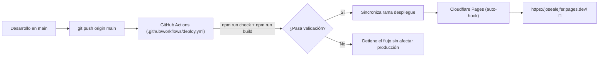

# Guía de Despliegue y CI/CD — Portafolio de José Fernández

Este documento describe la arquitectura de despliegue continuo (CI/CD), la gestión de ramas y los procedimientos para publicar actualizaciones en **Cloudflare Pages**.

* **Sitio en Producción**: [https://josealejfer.pages.dev/](https://josealejfer.pages.dev/)
* **Repositorio en GitHub**: [https://github.com/josealejferFB/Portfolio](https://github.com/josealejferFB/Portfolio)

---

## 1. Arquitectura de Ramas

El repositorio utiliza una estrategia de dos ramas diseñada para maximizar la velocidad de compilación y eliminar redundancias en producción:

| Rama | Propósito | Contenido |
|---|---|---|
| **`main`** | Desarrollo y fuente de verdad | Código fuente completo, tests, herramientas de auditoría visual (Playwright), capturas, exploraciones y documentación. |
| **`despliegue`** | Conectada a Cloudflare Pages | **Únicamente lo estrictamente necesario** para compilar el sitio estático (39 archivos frente a 106 de `main`). Excluye Playwright, capturas pesadas y notas de borrador. |



---

## 2. Métodos de Despliegue

### Vía 1: Despliegue 100 % Automático con GitHub Actions (Recomendado)

Cada vez que realizas un cambio en el código y lo subes a `main`:

```bash
# 1. Realiza tus cambios en src/, public/ o configuraciones
git add .
git commit -m "feat: actualizar proyectos o experiencia"

# 2. Sube a main
git push origin main
```

**Lo que ocurre automáticamente en GitHub:**
1. El workflow `.github/workflows/deploy.yml` se activa.
2. Ejecuta `npm ci` con Node.js 22.
3. Ejecuta `npm run check` (diagnóstico estático sin errores).
4. Ejecuta `npm run build` de prueba.
5. Ejecuta `node scripts/prepare-deploy.mjs` para empaquetar de forma limpia la rama `despliegue`.
6. Publica la rama `despliegue` en GitHub.
7. Cloudflare Pages detecta el nuevo commit y despliega en producción en ~15-20 segundos.

---

### Vía 2: Despliegue Inmediato desde la Terminal Local

Si prefieres validar y desplegar todo directamente desde tu consola con un solo comando:

```bash
npm run deploy
```

**Este comando realiza todo el ciclo en tu máquina:**
1. Valida el código (`npm run check`).
2. Verifica la compilación (`npm run build`).
3. Empaqueta la rama `despliegue` optimizada.
4. Hace push de `despliegue` a GitHub.
5. Regresa a `main` y hace push de `main` a GitHub.
6. Cloudflare Pages toma los cambios y actualiza el sitio en vivo.

---

### Vía 3: Solo Preparar la Rama de Despliegue (Sin hacer Push)

Si deseas generar o inspeccionar la rama `despliegue` localmente sin subir nada a remoto:

```bash
npm run prepare:deploy
```

---

## 3. Configuración en Cloudflare Pages

Si alguna vez necesitas reconectar o recrear el proyecto en Cloudflare Pages, los parámetros exactos son:

| Parámetro | Valor |
|---|---|
| **Project name** | `portfolio` |
| **Production branch** | `despliegue` |
| **Framework preset** | `Astro` |
| **Build command** | `npm run build` |
| **Build output directory** | `dist` |
| **Root directory** | `/` (raíz del proyecto) |
| **Node.js version** | `22` (garantizado vía `.node-version` y `.nvmrc` en el repositorio) |

---

## 4. Optimizaciones de Producción Activas

1. **Cabeceras HTTP y Caché ([public/_headers](file:///home/p0xd/Documentos/proyectos/Portfolio/public/_headers))**:
   * Bundles inmutables (`/_astro/*`, `/fonts/*`): `Cache-Control: public, max-age=31536000, immutable`.
   * Imágenes de proyectos (`/projects/*`): `Cache-Control: public, max-age=2592000, stale-while-revalidate=86400`.
   * HTML raíz: `Cache-Control: public, max-age=0, must-revalidate` (actualizaciones instantáneas para los visitantes).
   * Cabeceras estrictas de seguridad: `X-Content-Type-Options: nosniff`, `X-Frame-Options: SAMEORIGIN`, `Referrer-Policy: strict-origin-when-cross-origin`, y `Permissions-Policy` restrictiva.

2. **SEO y Metadatos**:
   * [public/robots.txt](file:///home/p0xd/Documentos/proyectos/Portfolio/public/robots.txt): Configurado para permitir indexación y referenciar el sitemap.
   * [public/sitemap.xml](file:///home/p0xd/Documentos/proyectos/Portfolio/public/sitemap.xml): Generado con la URL oficial `https://josealejfer.pages.dev/`.
   * [astro.config.mjs](file:///home/p0xd/Documentos/proyectos/Portfolio/astro.config.mjs): Detecta automáticamente `SITE_URL` o `CF_PAGES_URL` para OpenGraph y URLs canónicas.

---

## 5. Preguntas Frecuentes y Mantenimiento

### ¿Cómo actualizo el contenido de mi portafolio?
Toda la información del portafolio (proyectos, CV, textos, enlaces, experiencia) vive en **`src/content/site.ts`**. Edita este archivo, guarda los cambios y ejecuta `git push origin main` (o `npm run deploy`).

### ¿Cómo agrego un dominio personalizado?
En Cloudflare Pages:
1. Ve a tu proyecto `portfolio` > **Custom domains**.
2. Añade tu dominio (por ejemplo, `josefernandez.dev`).
3. Cloudflare configurará el certificado SSL y el enrutamiento de forma automática.
4. Opcionalmente añade la variable de entorno `SITE_URL = https://tudominio.com` en Cloudflare Pages > Settings > Environment variables.
